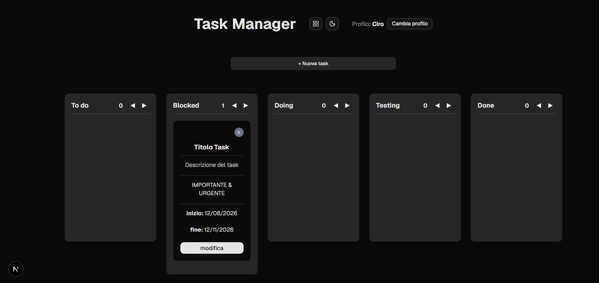
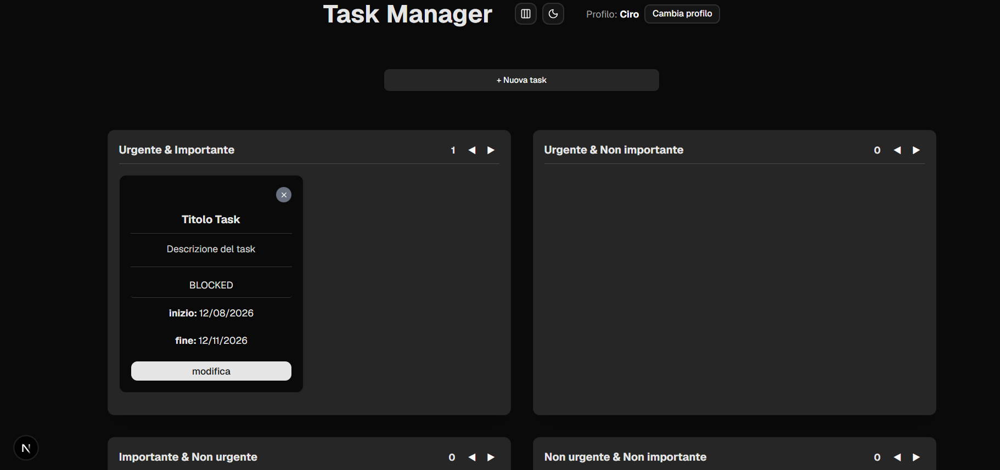
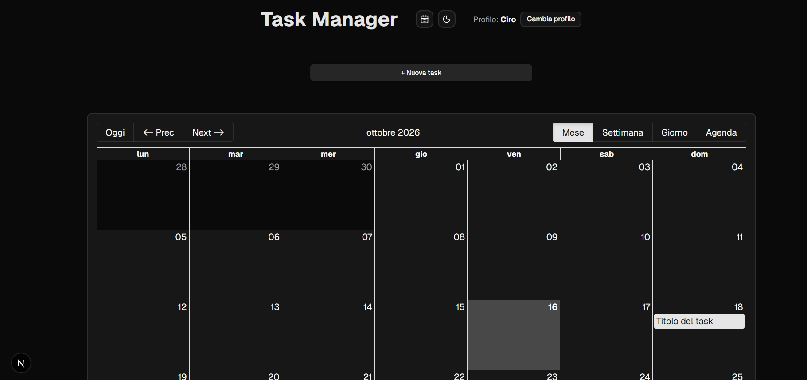

# Task Manager

Task manager in Next.js con tre viste sulla stessa lista di task: **Kanban** (To do, Blocked, Doing, Testing, Done), **matrice di Eisenhower** (urgente / importante) e **calendario** delle scadenze.

Funziona subito in locale, senza configurazione. Se vuoi, puoi attivare un login vero e il salvataggio su database con **Supabase**.

<p align="center">
  
</p>

| Matrice di Eisenhower | Calendario delle scadenze |
| --- | --- |
|  |  |

## Funzionalità

- Creazione, modifica ed eliminazione delle task, con validazione del form (Zod e React Hook Form)
- Spostamento delle task tra le colonne con drag & drop
- Vista Kanban, matrice di Eisenhower e calendario, con la vista scelta che resta salvata
- Colonne riordinabili e contatore delle task per colonna
- Bordo rosso sulle task in scadenza entro un giorno
- Tema chiaro, scuro o di sistema
- Due modalità di salvataggio:
  - **locale** (predefinita): profili senza password, ognuno con le sue task, salvati nel browser
  - **Supabase**: registrazione e accesso con email e password, ogni utente vede solo le proprie task

## Tecnologie

- **Next.js 16** (App Router) e **React 19** con **TypeScript**
- **TanStack Query** per caricare e modificare le task, con aggiornamento immediato e ritorno allo stato precedente se il salvataggio fallisce
- **Zod** e **React Hook Form** per la validazione
- **Tailwind CSS 4** e componenti **shadcn/ui**
- **react-big-calendar** e **date-fns** per il calendario
- **Supabase** (Auth e Postgres con Row Level Security), opzionale

## Come avviarlo

Requisiti: [Node.js](https://nodejs.org/) 20.9 o successivo.

```bash
git clone https://github.com/francescoesposito-geeks/task-manager.git
cd task-manager
npm install
npm run dev
```

Poi apri [http://localhost:3000](http://localhost:3000), crea un profilo e inizia ad aggiungere task.

| Comando         | Cosa fa                                 |
| --------------- | --------------------------------------- |
| `npm run dev`   | Server di sviluppo                      |
| `npm run build` | Build di produzione                     |
| `npm run start` | Avvia la build di produzione            |
| `npm run lint`  | Controllo del codice con ESLint         |

## Modalità Supabase (opzionale)

1. Crea un progetto gratuito su [supabase.com](https://supabase.com).
2. Nel pannello del progetto apri **SQL Editor**, incolla il contenuto di [`supabase/schema.sql`](supabase/schema.sql) e premi **Run**. Lo script crea la tabella `tasks` (o aggiorna quella esistente) e attiva la **Row Level Security**: ogni utente può leggere e modificare solo le proprie task.
3. In **Authentication → URL Configuration** imposta **Site URL** a `http://localhost:3000`, così il link dell'email di conferma riporta all'app.
4. Nella cartella del progetto, copia `.env.example` in `.env.local` e inserisci i valori presi da **Settings → API Keys** (oppure dal pulsante **Connect**):

   ```
   NEXT_PUBLIC_TASKS_STORAGE=supabase
   NEXT_PUBLIC_SUPABASE_URL=https://il-tuo-progetto.supabase.co
   NEXT_PUBLIC_SUPABASE_PUBLISHABLE_KEY=sb_publishable_...
   ```

   Usa la chiave **publishable**, mai la **secret**: la secret salta la Row Level Security e non deve mai finire nel browser. Funziona anche la vecchia chiave `anon` con il nome `NEXT_PUBLIC_SUPABASE_ANON_KEY`, ma Supabase la sta dismettendo.

5. Riavvia `npm run dev`. Al posto dei profili locali compare la schermata di accesso e registrazione.

Il file `.env.local` è escluso da Git: le chiavi restano solo sul tuo computer. La chiave publishable è pensata per stare nel browser; a proteggere i dati sono le regole di Row Level Security dello script SQL.

Per tornare alla modalità locale basta impostare `NEXT_PUBLIC_TASKS_STORAGE=local` (o togliere la riga) e riavviare.

## Struttura del progetto

```
task-manager/
├── app/
│   ├── components/        # board, colonne, task, form, profili, login, provider della sessione
│   │   └── ui/            # componenti shadcn/ui
│   ├── layout.tsx
│   ├── page.tsx           # profili o login, poi la board
│   └── providers.tsx      # TanStack Query, tema, sessione
├── data/                  # colonne iniziali e opzioni dei select
├── docs/                  # screenshot usati in questo README
├── hooks/                 # useTasks (TanStack Query), useLocalStorage, useIsClient
├── lib/
│   ├── config.ts          # modalità scelta con NEXT_PUBLIC_TASKS_STORAGE
│   ├── db/                # accesso alle task: interfaccia comune, versione locale e Supabase
│   ├── mappers/           # conversione tra righe del database e oggetti Task
│   ├── schemas/           # schemi Zod di task, login e profili
│   ├── session/           # contesto della sessione e profili locali
│   └── supabase/          # client Supabase, creato solo in modalità Supabase
├── supabase/schema.sql    # tabella e regole di sicurezza per Supabase
├── types/                 # tipi TypeScript
└── utils/                 # scadenze e colonne della matrice
```

## Scelte tecniche

- **Un'unica interfaccia per i dati** (`lib/db/task.ts`): i componenti chiamano sempre `fetchTasks`, `createTask`, `updateTask` e `deleteTask`, senza sapere se le task finiscono nel browser o su Supabase. Cambiare modalità non richiede di toccare i componenti.
- **Nessuna password nel browser**: in modalità locale i profili servono solo a separare le board e non hanno password. L'autenticazione vera è solo quella di Supabase, dove la password viene verificata dal server.
- **Errori visibili**: se un caricamento o un salvataggio fallisce compare un messaggio, e le modifiche fatte in anticipo sulla board (per esempio uno spostamento) vengono annullate.
- **Dati salvati validati**: le task lette da `localStorage` vengono controllate con Zod, così un dato rovinato non blocca l'app.

## Contesto

Progetto realizzato durante lo stage da sviluppatore web presso Geekcreations S.r.l. (giugno–luglio 2026).
